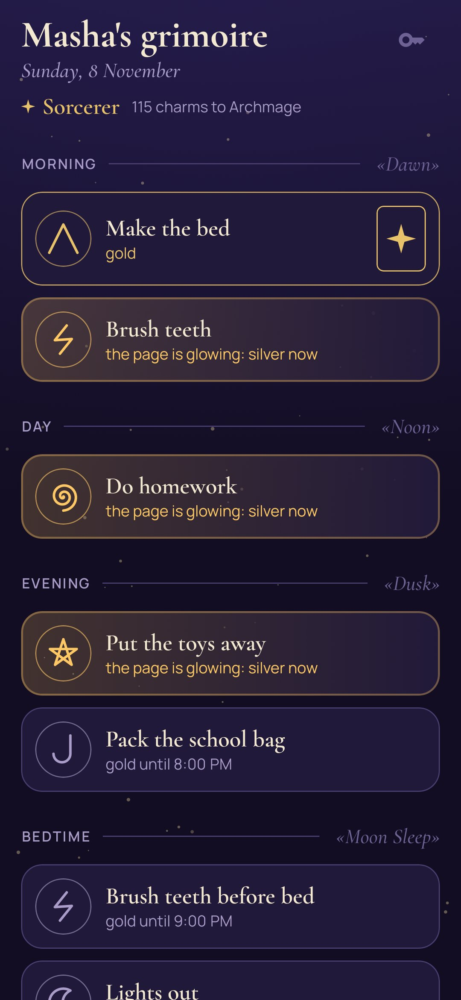
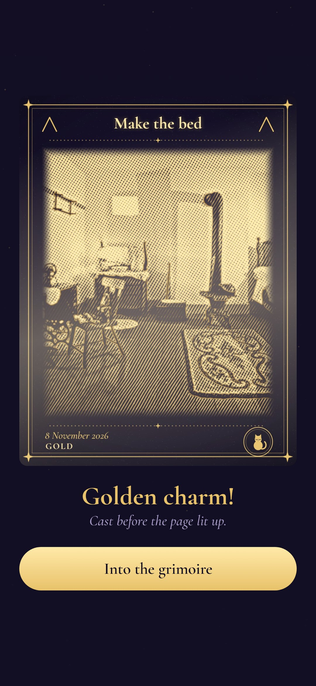
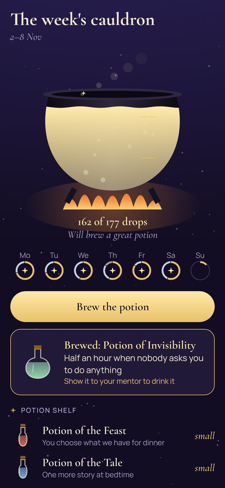
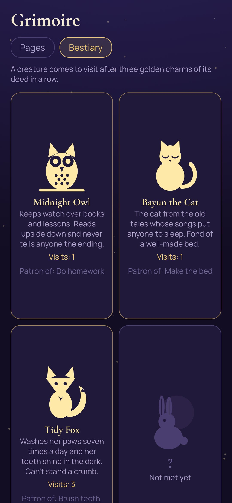

<div align="center">


# Charms

### A grimoire for a young sorcerer: everyday deeds become golden engravings

*Make the bed, brush your teeth, do your homework, pack your bag: every deed of the day is a page of a grimoire with its own magic hour. When it's done, the child photographs it with the phone's own camera and the picture turns into an engraving. Done before the page lights up, it comes out in gold. The app does the reminding, so the grown-ups don't have to, and a week of charms brews a potion that is a real reward. Free, no ads, no internet.*

[](https://github.com/bigdevwhale/charms/actions/workflows/android.yml)
[](https://github.com/bigdevwhale/charms/releases/latest)


[](LICENSE)

**English** · [Русский](README.ru.md) · [Changelog](CHANGELOG.md)

   

**[Download the APK](https://github.com/bigdevwhale/charms/releases/latest/download/Charms.apk)** · Android 8+

</div>

---

## Gold, silver and ink

- **The magic hour.** Every page has its hour. Before it the page is quiet, and a charm cast then comes out in **gold**.
- **The page lights up.** At its hour the page starts to glow and a quiet notification comes: the app reminds instead of you. From then on it's **silver**.
- **The bell.** If a grown-up still has to remind, they don't raise their voice: they ring the bell on the mentor's page, and the child's phone goes «ding». A charm cast after that comes out in **ink**. It still counts.
- **Seals.** A deed that can't be photographed (lights out) is sealed by holding a finger on it until the ring closes.

## The engraving

The picture is engraved on the phone itself: light becomes metal hatching, crossed in the brightest places, with fine outlines along the edges. Around it there's a frame with the deed's name between two sigils, the date, the metal and the deed's patron creature in a medallion. The original photo is deleted straight away; only the engraving stays in the grimoire. If you'd rather keep photographs, the mentor turns engravings off and the picture stays a colour photo in the same frame.

## Spells, the cauldron and potions

- **Spells.** When every page of a part of the day is charmed, a spell is cast: **Dawn**, **Noon**, **Dusk** or **Moon Sleep**. It adds two more drops to the cauldron.
- **The cauldron.** A week of charms fills it over the fire: gold gives three drops, silver two, ink one, a blot none.
- **Potions.** On Sunday the cauldron brews a **small**, **middling** or **great** potion, and the child picks one from the shelf. Each potion is a real reward the family chose together: dinner of your choice, one more story at bedtime, half an hour when nobody asks for anything, going to bed an hour later on Friday, a trip to the funfair.

## The bestiary and ranks

Eight creatures from the tales look after the deeds: the **Midnight Owl** (homework and reading), **Bayun the Cat** (the made bed), the **Tidy Fox** (teeth), the **Moon Hare** (walks), the **Keeper Raven** (the school bag), the **Housekeeping Hedgehog** (tidying), the **Water Snail** (the shower) and the **Lamplighter Firefly** (lights out). After three golden charms of a deed in a row, its patron comes to visit and stands right on the engraving. Ranks grow with the grimoire: **Apprentice**, **Journeyman**, **Sorcerer**, **Archmage**.

## The mentor's page

Four digits only the grown-up knows. There:

- deeds, their part of the day, magic hour, days of the week, what to photograph, sigil and patron;
- the potion shelf;
- today's pages: ring the bell, look at a picture, put a **blot** on one that isn't the deed (its drops leave the cauldron);
- **a day of rest** when someone is ill or the day is hard: nothing is asked and nothing is lost;
- brewed potions to give out, language, engravings on or off, community links.

No crosses, no lost streaks, no shame.

## Privacy

Everything stays on the phone. The app has no internet permission and no camera permission: pictures are taken by the phone's own camera app, turned into engravings on the device and deleted. No accounts, no ads, no analytics.

## Build

```
./gradlew assembleDebug                      # app.charms.dev, next to a real install
./gradlew assembleDebug -Pdemo               # app.charms.demo: two weeks of charms
./gradlew testDebugUnitTest                  # the rules: metals, visitors, spells, the cauldron
./gradlew testDebugUnitTest -Prender --tests '*RenderScreens*' --rerun && python tools/shots.py   # screenshots
./gradlew testDebugUnitTest -Prender --tests '*RenderArt*' -Pphotos=<folder>   # engrave any pictures
```

Kotlin, Jetpack Compose, Room, DataStore. The engraving, the frame, the sigils and the creatures are drawn in code. Fonts: Cormorant, Manrope (SIL OFL).

Part of [StillCraft](https://bigdevwhale.github.io/stillcraft/). MIT licence.

The demo engraves public-domain and CC0 pictures from Wikimedia Commons, listed in [docs/DEMO-PICTURES.md](docs/DEMO-PICTURES.md).
