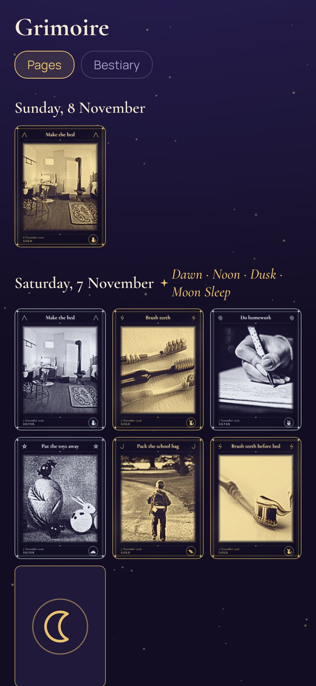
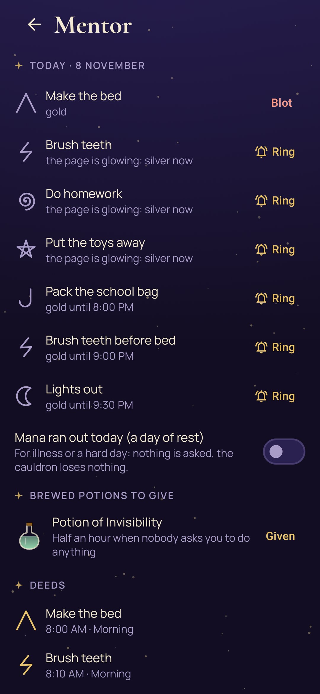

# Charms

**A grimoire for a young sorcerer: everyday deeds become golden engravings, and a week of them brews a real reward.** · [Русская версия](README.ru.md)

Charms is for children who are tired of being reminded and for grown-ups who are tired of reminding.
Every deed of the day (make the bed, brush teeth, homework, pack the bag) is a page of a grimoire.
When it's done, the child photographs it with the phone's own camera, and the picture turns into an
engraving in gold. The app does the reminding, and getting there first is the game.

- **The magic hour.** Each page has its hour. A charm cast before it comes out in gold. At the hour the
  page lights up (a quiet notification), and from then on it's silver. If a grown-up still has to remind,
  they ring the bell in the app instead of raising their voice, and the charm comes out in ink. It still counts.
- **Engravings.** The picture is engraved on the phone in gold, silver or ink hatching, framed with the
  deed's name, its sigil and its patron creature. The original photo is deleted at once. A mentor's switch
  can keep pictures as plain colour photographs in the same frame instead.
- **Spells.** When every page of a part of the day is charmed, a spell is cast: Dawn, Noon, Dusk or Moon Sleep.
  It adds two more drops to the cauldron.
- **The cauldron.** A week of charms fills it: gold gives three drops, silver two, ink one. On Sunday it brews
  a small, middling or great potion, and the child picks one from the shelf. Each potion is a real reward the
  family chose together: dinner of their choice, one more story, half an hour when nobody asks for anything,
  a trip to the funfair.
- **The bestiary.** Eight creatures from the tales (the Midnight Owl, Bayun the Cat, the Tidy Fox, the Moon Hare
  and others) each look after their deeds. After three golden charms of a deed in a row, its patron comes to
  visit, right on the engraving.
- **Ranks** from Apprentice to Archmage grow with the grimoire.
- **The mentor's page** opens with four digits. There the grown-up sets deeds, hours and days, fills the potion
  shelf, rings the bell, puts a blot on a picture that isn't the deed, gives out brewed potions and marks a day
  of rest when someone is ill.
- **Gentle by design.** No crosses, no lost streaks, no shame. A day of rest asks nothing and loses nothing.

Everything stays on the phone. The app has no internet permission and never opens the camera itself.

| | | |
|---|---|---|
|  |  |  |
|  |  |  |

## Build

```
./gradlew assembleDebug                 # app.charms.dev
./gradlew assembleDebug -Pdemo          # app.charms.demo: two weeks of charms
./gradlew testDebugUnitTest -Prender --tests '*RenderScreens*' --rerun && python tools/shots.py
./gradlew testDebugUnitTest -Prender --tests '*RenderArt*' -Pphotos=<folder>   # engrave any pictures
```

The demo engraves public-domain and CC0 pictures from Wikimedia Commons, listed in [docs/DEMO-PICTURES.md](docs/DEMO-PICTURES.md).
Fonts: Cormorant, Manrope (SIL Open Font License). MIT licence.
