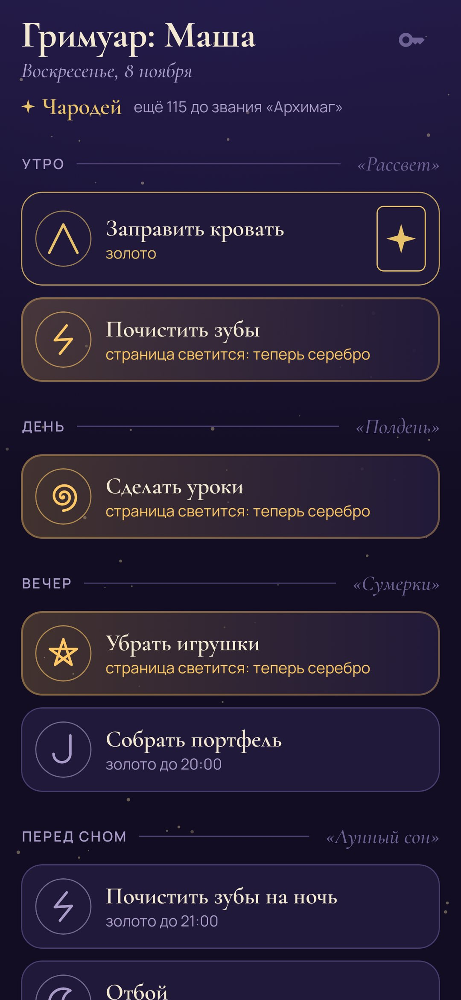
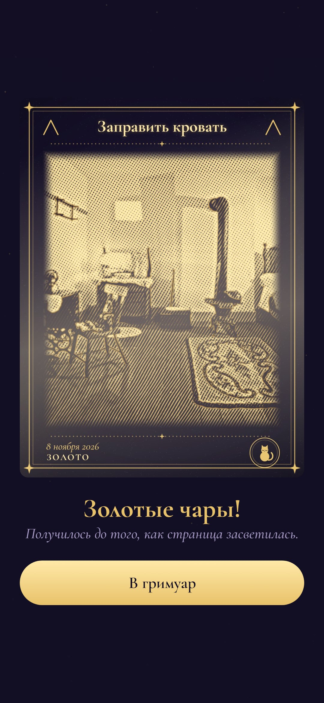
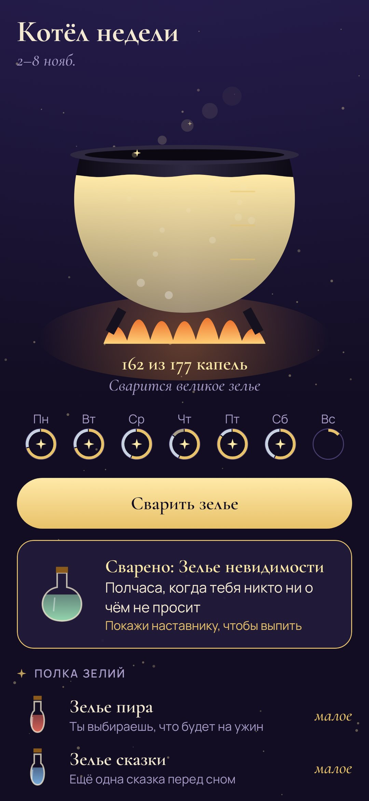
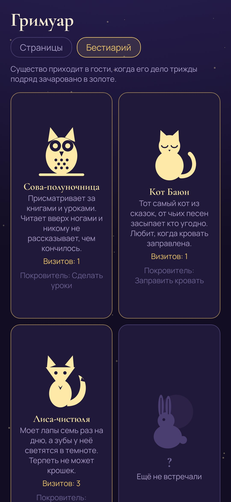

<div align="center">


# Чары

### Гримуар юного чародея: обычные дела становятся золотыми гравюрами

*Заправить кровать, почистить зубы, сделать уроки, собрать портфель — каждое дело дня здесь страница гримуара со своим магическим часом. Когда дело сделано, ребёнок снимает его обычной камерой телефона, и снимок превращается в гравюру. Успел, пока страница не засветилась, — гравюра выходит золотой. Напоминает само приложение, так что взрослым не приходится повторять одно и то же, а за неделю чары варят зелье, и это настоящая награда. Бесплатно, без рекламы, без интернета.*

[](https://github.com/bigdevwhale/charms/actions/workflows/android.yml)
[](https://github.com/bigdevwhale/charms/releases/latest)

[](LICENSE)

[English](README.md) · **Русский** · [Изменения](CHANGELOG.md)

   

**[Скачать APK](https://github.com/bigdevwhale/charms/releases/latest/download/Charms.apk)** · Android 8+

</div>

---

## Золото, серебро и тушь

- **Магический час.** У каждой страницы свой час. До него страница спокойна, и чары выходят **золотыми**.
- **Страница засвечивается.** В свой час она начинает светиться, и приходит тихое уведомление: напоминает приложение, а не вы. Дальше чары уже **серебряные**.
- **Колокольчик.** Если взрослому всё-таки пришлось напомнить, он не повышает голос, а звонит в колокольчик на странице наставника, и телефон ребёнка тихонько звякает. Чары после этого выйдут **тушью**, но всё равно засчитаются.
- **Печать.** Дело, которое не сфотографируешь (например, отбой), запечатывают: держат палец, пока не замкнётся кольцо.

## Гравюра

Снимок гравируется прямо на телефоне: свет превращается в штрихи металла, в самых светлых местах они перекрещиваются, а по краям предметов идёт тонкий контур. Вокруг рамка: название дела между двумя знаками, дата, металл и существо-покровитель в медальоне. Само фото сразу удаляется, в гримуаре остаётся только гравюра. Если хочется оставить обычные снимки, наставник выключает превращение, и фото остаётся цветным в той же рамке.

## Заклинания, котёл и зелья

- **Заклинания.** Когда зачарованы все страницы одной части дня, складывается заклинание: **«Рассвет»**, **«Полдень»**, **«Сумерки»** или **«Лунный сон»**. За него в котёл падают ещё две капли.
- **Котёл.** Его наполняет неделя чар: золото даёт три капли, серебро две, тушь одну, клякса — ни одной.
- **Зелья.** В воскресенье котёл варит **малое**, **среднее** или **великое** зелье, и ребёнок выбирает его с полки. Каждое зелье — настоящая награда, которую семья придумала вместе: ужин на выбор, ещё одна сказка перед сном, полчаса, когда никто ни о чём не просит, в пятницу лечь на час позже, поездка на аттракционы.

## Бестиарий и звания

За делами присматривают восемь сказочных существ: **Сова-полуночница** (уроки и чтение), **Кот Баюн** (заправленная кровать), **Лиса-чистюля** (зубы), **Лунный заяц** (прогулки), **Ворон-хранитель** (портфель), **Ёж-хозяин** (уборка), **Улитка-водяница** (душ) и **Светлячок-фонарщик** (отбой). Если дело трижды подряд зачаровано в золоте, его покровитель приходит в гости и появляется прямо на гравюре. Вместе с гримуаром растут звания: **ученик**, **подмастерье**, **чародей**, **архимаг**.

## Страница наставника

Открывается четырьмя цифрами, которые знает только взрослый. Там:

- дела: часть дня, магический час, дни недели, что снимать, знак и покровитель;
- полка зелий;
- страницы сегодняшнего дня: позвонить в колокольчик, посмотреть снимок, поставить **кляксу**, если на нём явно не то дело (его капли уйдут из котла);
- **день отдыха**, если кто-то заболел или день выдался тяжёлый: ничего не задано и ничего не теряется;
- сваренные зелья, которые пора выдать, язык, гравюры или обычные фото, ссылки на сообщество.

Никаких крестиков, сгоревших серий и стыда.

## Приватность

Всё хранится на телефоне. У приложения нет доступа ни к интернету, ни к камере: снимает обычная камера телефона, снимок превращается в гравюру на самом устройстве и удаляется. Без аккаунтов, рекламы и аналитики.

## Сборка

```
./gradlew assembleDebug                      # app.charms.dev, рядом с обычной установкой
./gradlew assembleDebug -Pdemo               # app.charms.demo: две недели чар
./gradlew testDebugUnitTest                  # правила: металлы, гости, заклинания, котёл
./gradlew testDebugUnitTest -Prender --tests '*RenderScreens*' --rerun && python tools/shots.py   # скриншоты
./gradlew testDebugUnitTest -Prender --tests '*RenderArt*' -Pphotos=<папка>   # выгравировать любые снимки
```

Kotlin, Jetpack Compose, Room, DataStore. Гравюра, рамка, знаки и существа нарисованы кодом. Шрифты: Cormorant, Manrope (SIL OFL).

Часть [StillCraft](https://bigdevwhale.github.io/stillcraft/). Лицензия MIT.

Демо гравирует снимки с Wikimedia Commons в общественном достоянии и под CC0, список — в [docs/DEMO-PICTURES.md](docs/DEMO-PICTURES.md).
