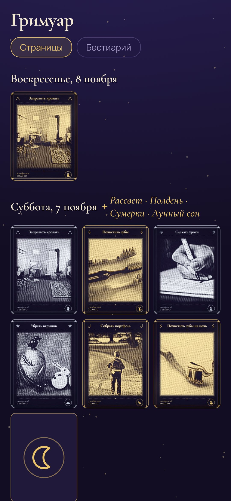
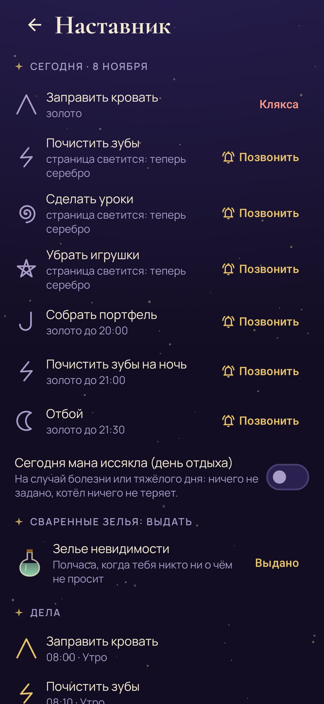

# Чары

**Гримуар юного чародея: обычные дела превращаются в золотые гравюры, а за неделю из них варится настоящая награда.** · [English](README.md)

«Чары» для детей, которым надоело, что им напоминают, и для взрослых, которым надоело напоминать.
Каждое дело дня — заправить кровать, почистить зубы, сделать уроки, собрать портфель — это страница
гримуара. Когда дело сделано, ребёнок фотографирует его обычной камерой телефона, и снимок превращается
в золотую гравюру. Напоминает само приложение, а игра в том, чтобы успеть раньше него.

- **Магический час.** У каждой страницы свой час. Если зачаровать её раньше, чары выйдут золотыми.
  В свой час страница засветится (придёт тихое уведомление), и дальше будет уже серебро. Если взрослому
  всё-таки пришлось напомнить, он не повышает голос, а звонит в приложении в колокольчик. Тогда чары
  выйдут тушью, но всё равно засчитаются.
- **Гравюры.** Снимок гравируется прямо на телефоне штрихами золота, серебра или туши, а вокруг рамка
  с названием дела, его знаком и существом-покровителем. Само фото сразу удаляется. Если наставник
  выключит превращение, снимок останется цветной фотографией в той же рамке.
- **Заклинания.** Когда зачарованы все страницы одной части дня, складывается заклинание: «Рассвет»,
  «Полдень», «Сумерки» или «Лунный сон». За него в котёл падают ещё две капли.
- **Котёл.** Его наполняет неделя чар: золото даёт три капли, серебро две, тушь одну. В воскресенье котёл
  варит малое, среднее или великое зелье, и ребёнок выбирает его с полки. Каждое зелье — настоящая награда,
  которую семья придумала вместе: ужин на выбор, ещё одна сказка, полчаса, когда никто ни о чём не просит,
  поездка на аттракционы.
- **Бестиарий.** Восемь сказочных существ — Сова-полуночница, Кот Баюн, Лиса-чистюля, Лунный заяц и другие —
  присматривают каждое за своими делами. Если дело трижды подряд зачаровано в золоте, его покровитель
  приходит в гости и появляется прямо на гравюре.
- **Звания** — от ученика до архимага — растут вместе с гримуаром.
- **Страница наставника** открывается четырьмя цифрами. Там взрослый настраивает дела, их часы и дни,
  ставит зелья на полку, звонит в колокольчик, ставит кляксу на снимок, где явно не то дело, выдаёт
  сваренные зелья и отмечает день отдыха, если кто-то заболел.
- **Без наказаний.** Никаких крестиков, сгоревших серий и стыда. В день отдыха ничего не задано и ничего не теряется.

Всё хранится на телефоне. У приложения нет доступа в интернет, а свою камеру оно не открывает:
снимает обычная камера телефона.

| | | |
|---|---|---|
|  |  |  |
|  |  |  |
